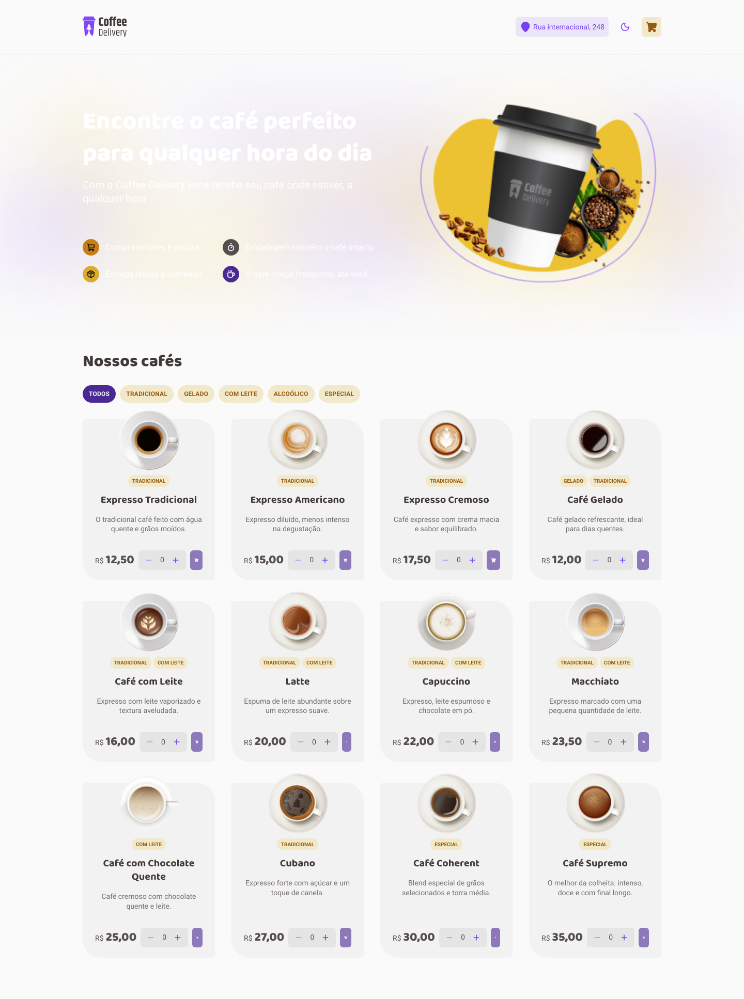
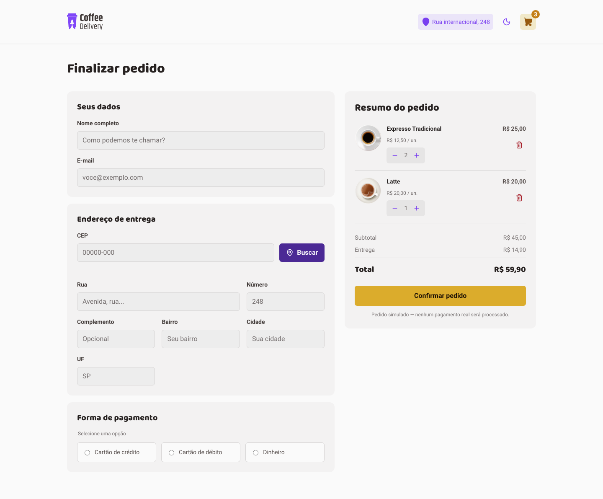
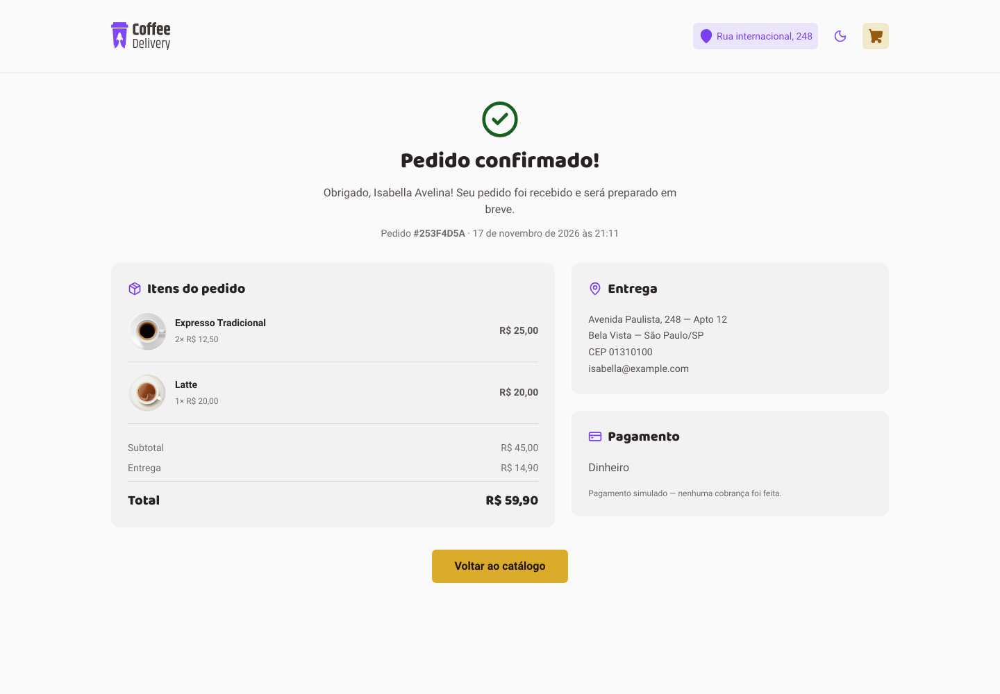
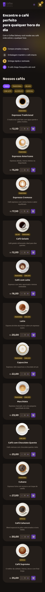
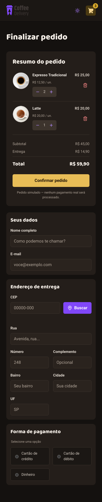
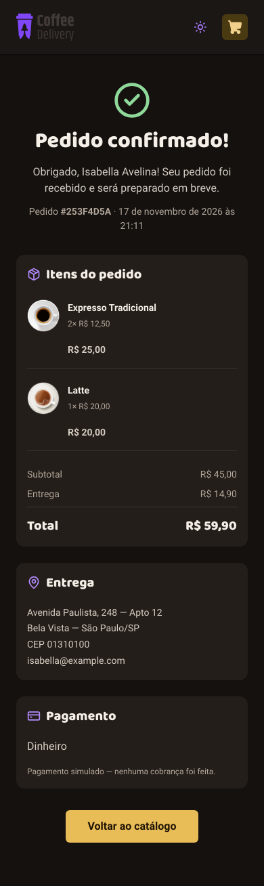

# Coffee Delivery

Trabalho final da disciplina de Single Page Application: e-commerce de cafés com
catálogo filtrável, carrinho com `useReducer`, checkout com consulta ViaCEP, pagamento
simulado e confirmação de pedido. Interface responsiva, acessível (WCAG 2.2 AA) e com
tema claro/escuro persistente.

**Repositório público:** https://github.com/isaave/Coffee-Delivery
**Link de publicação:** _pendente_ (a aplicação ainda não foi publicada; ver [Publicação](#publicação)).

## Objetivos

- Exibir 12 cafés com imagem, nome, descrição, preço e seletor de quantidade.
- Permitir adicionar, incrementar, decrementar e remover itens sem duplicar linhas.
- Consultar uma API pública (ViaCEP) pelo CEP e preencher automaticamente rua, bairro,
  cidade e UF, mantendo número e complemento como campos manuais.
- Calcular subtotal, frete por região e total em BRL (centavos inteiros).
- Validar o checkout com React Hook Form + Zod, exigir forma de pagamento e **não**
  processar pagamento real.
- Impedir confirmação com carrinho vazio ou formulário inválido e exibir comprovante
  com os dados do pedido confirmado.
- Manter light/dark persistente, contraste AA e layout utilizável de 320 a 1440 px.

## Stack

| Camada | Tecnologia |
| --- | --- |
| UI | React 19 + Vite 8 + TypeScript (strict, `erasableSyntaxOnly`) |
| Navegação | React Router (`/`, `/checkout`, `/success`, fallback) |
| Estado | Context API + `useReducer` (carrinho) e Context API (tema) |
| Formulário | React Hook Form + Zod (`@hookform/resolvers`) |
| API pública | ViaCEP (`https://viacep.com.br/ws/{cep}/json/`) |
| Estilos | CSS com tokens semânticos (`tokens.css`) e fontes Roboto + Baloo 2 |
| Testes | Vitest (testes unitários e de regressão de contraste) |
| Lint | Oxlint |

## Requisitos

- Node.js 20.19+ (recomendado: 22+)
- npm 11+

## Instalação e scripts

```bash
npm install
npm run dev        # servidor de desenvolvimento (http://127.0.0.1:5173)
npm run build      # checagem TypeScript (tsc -b) + build de produção
npm run lint       # oxlint
npm test           # testes unitários (Vitest) — 122 testes
npm run typecheck  # somente TypeScript
npm run preview    # serve o build de produção localmente
```

## Estrutura

```
src/
  components/  Header, Hero, ProductCard, CartSummary, FormField, QuantityStepper...
  pages/       CatalogPage, CheckoutPage, SuccessPage
  contexts/    ThemeProvider, CartProvider (contexts separados para Fast Refresh)
  reducers/    cartReducer (puro e imutável)
  hooks/       useTheme, useCart, useCep
  data/        products.ts (12 cafés tipados)
  types/       product, cart, theme, checkout
  schemas/     checkoutSchema (Zod)
  utils/       storage, money, totals, cep, shipping, order
  styles/      tokens.css, global.css
  tests/       reducer, guards, dinheiro, totais, contraste, schema, CEP, frete, pedido
docs/
  PRD_SPEC.md      produto, histórias, RFs e RNs
  TECH_SPEC.md     stack, arquitetura e convenções
  TASKS_SPEC.md    planejamento task a task e status
  AI_USAGE.md      evidências do uso de IA
  DEMO.md          demonstração do fluxo de compra
  screenshots/     capturas desktop/mobile, claro/escuro
AGENTS.md            instruções e decisões para agentes
```

`App.tsx` é uma camada fina: apenas provedores, layout e rotas. Toda regra de negócio
vive em reducers, hooks, schemas e utilitários testados.

## Decisões

- **Pagamento:** simulado. Não há gateway, credenciais ou `fetch` de pagamento.
- **Frete (RN-03):** por UF — Norte R$ 25,90, Nordeste R$ 19,90, Centro-Oeste R$ 22,90,
  Sudeste R$ 14,90, Sul R$ 12,90; padrão R$ 14,90 quando a UF é desconhecida. Um CEP
  inválido nunca altera o frete.
- **Valores:** sempre em centavos inteiros e formatados com `Intl.NumberFormat('pt-BR')`.
- **Persistência:** chaves versionadas `coffee-delivery:cart:v1`,
  `coffee-delivery:theme:v1` e `coffee-delivery:order:v1`, todas validadas antes do uso.
- **Branding:** a logo oficial do Figma foi mantida em `public/images/logo.svg` para
  fidelidade visual. O item "logo criada com IA" do enunciado foi substituído por essa
  decisão; o uso de IA está registrado em `docs/AI_USAGE.md`.
- **Publicação:** adiada por decisão do titular do repositório; ver abaixo.
- **`npm audit`:** o Vite 8 depende de `picomatch@4.0.7`, com a advisory
  GHSA-fc5q-39xc-vjpf (ReDoS em globs) sem versão corrigida publicada. É dependência
  exclusiva de dev/build e os padrões de glob não vêm de entrada do usuário; risco
  prático baixo neste projeto.

## Design de referência

- **Figma:** https://www.figma.com/design/yGPNTA0Yczb183EikXGIiA/Coffee-Delivery-%E2%80%A2-Projeto-Final-React?node-id=0-1&t=OlmxjofHqaQgxTZg-1
- Paleta canônica: roxo `#8047F8` / `#4B2995`, amarelo `#DBAC2C` / `#C47F17`,
  fundo `#FAFAFA`, card `#F3F2F2`; tipografia Roboto e Baloo 2.
- Assets (logo, fundo do hero, xícara e 12 cafés) extraídos do Figma e servidos em
  `public/images/`.

## Screenshots

**Desktop — tema claro**

| Home | Checkout | Sucesso |
| --- | --- | --- |
|  |  |  |

**Mobile (390 px) — tema escuro**

| Home | Checkout | Sucesso |
| --- | --- | --- |
|  |  |  |

O roteiro completo está em [`docs/DEMO.md`](docs/DEMO.md).

## Acessibilidade e validação

- Tokens semânticos com contraste WCAG 2.2 AA nos dois temas, incluindo hover, ícones,
  bordas de controle, placeholder, badge e estado marcado dos radios; foco visível,
  alvos de toque de 44 px e `prefers-reduced-motion`.
- `--color-on-yellow`, `--color-on-primary`, `--color-icon-neutral-bg`,
  `--color-primary-surface-hover`, `--color-on-badge` e `--color-control-accent` garantem
  que nenhum texto ou ícone dependa da cor do fundo.
- `contrast.test.ts` verifica 37 pares × 2 temas diretamente dos tokens CSS mais uma
  invariante de paridade de tokens (75 testes de tema).
- **122 testes** passando; `npm run lint` e `npm run build` sem erros
  (1 aviso informativo do React Compiler em `useForm`).
- **Lighthouse 100/100/100** (Acessibilidade, Boas Práticas, SEO) em Home, Checkout e
  Sucesso, nos temas claro e escuro, sem falhas.
- Validação manual em navegador: ViaCEP real, erros de CEP, validação de pagamento,
  carrinho vazio, confirmação, persistência após refresh e dark mode nas três telas.
- Estilos computados conferidos via DevTools nas três telas e nos dois temas: nenhum par
  de texto/borda ficou abaixo de 4,5:1 (texto) ou 3:1 (ícones e UI).

## Uso de IA

As evidências com prompts, resultados, arquivos e commits estão em
[`docs/AI_USAGE.md`](docs/AI_USAGE.md).

## Publicação

O link da aplicação publicada ficará pendente até que o titular escolha a plataforma
(Vercel, Netlify ou GitHub Pages) e forneça a URL. O build de produção já está pronto
(`npm run build` → `dist/`).
