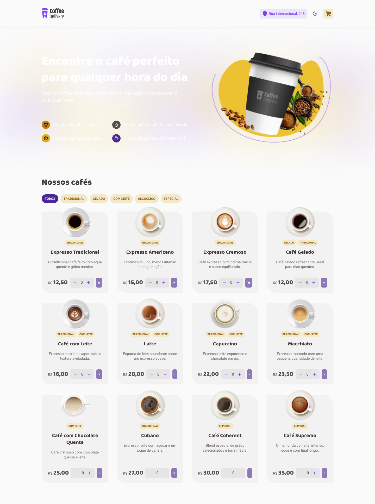
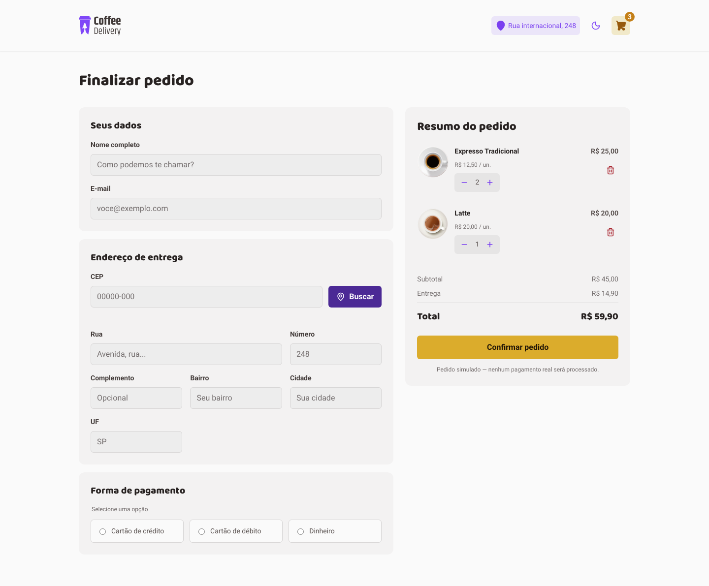
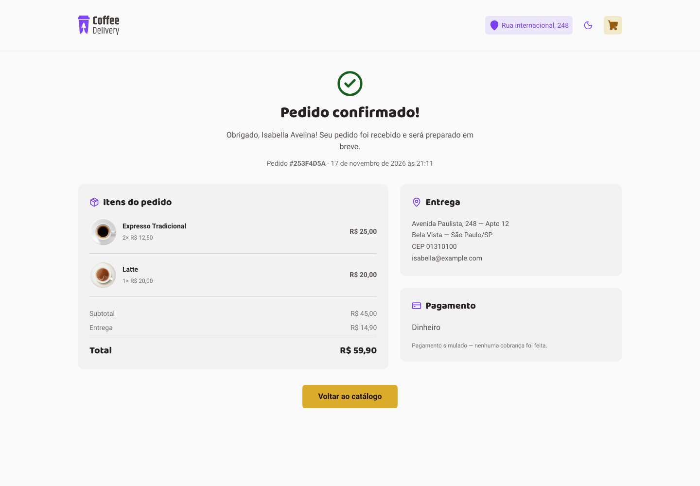
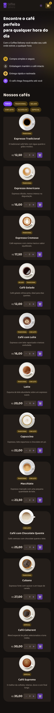
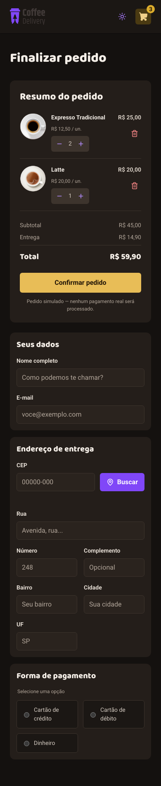
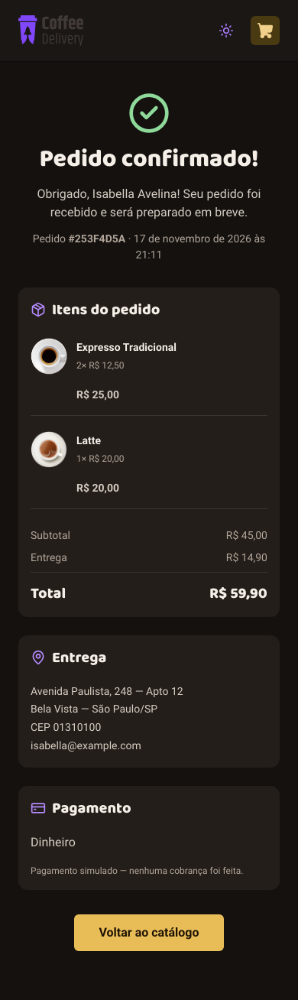

# Demonstração do fluxo de compra

Breve roteiro para reproduzir e conferir o fluxo completo. As imagens abaixo estão em
`docs/screenshots/` e também são usadas no README.

## 1. Catálogo — escolher os cafés

Abra a Home. Cada card mostra imagem, nome, descrição, preço, stepper de quantidade e
botão "Adicionar" (desabilitado enquanto a quantidade é 0).

1. Aumente a quantidade de **Expresso Tradicional** para 2 e adicione.
2. Adicione 1 unidade de **Latte**.
3. Confira o badge do Header: **3 itens** (soma das unidades, não das linhas).

## 2. Carrinho — revisar e ajustar

Clique no ícone de carrinho no Header. A rota `/checkout` exibe o resumo com:

- uma linha por produto (sem duplicatas — adicionar o mesmo café acumula quantidade);
- botões `−`/`+` e ícone de lixeira em cada linha;
- subtotal, entrega e total em BRL;
- o botão **Confirmar pedido**.

Decrementar até zero remove a linha. Se o carrinho ficar vazio, a página mostra o
estado vazio com link de volta ao catálogo e o formulário deixa de ser exibido —
portanto não é possível confirmar um pedido sem itens.

## 3. Checkout — endereço e pagamento

Preencha nome e e-mail. No campo CEP:

1. Digite `01310-100` e clique em **Buscar**.
2. O hook `useCep` consulta ViaCEP, mostra "Buscando endereço..." e preenche
   automaticamente **Rua** (Avenida Paulista), **Bairro** (Bela Vista), **Cidade**
   (São Paulo) e **UF** (SP).
3. Número e complemento permanecem manuais. Com SP, a entrega é R$ 14,90.
4. Para conferir a regra de frete, busque `59010-000`: cidade Natal/UF RN e entrega
   passa a R$ 19,90. Volte ao CEP de São Paulo para o pedido final.

CEP inválido (ex.: `123`) exibe "Informe um CEP válido com 8 dígitos." sem consultar a
API. CEP inexistente exibe "CEP não encontrado." sem apagar os dados já preenchidos.
Requisições antigas são abortadas quando um novo CEP é digitado.

Por fim, selecione uma forma de pagamento (cartão de crédito, cartão de débito ou
dinheiro). O campo é obrigatório e **nenhum pagamento real é processado**.

Tentar confirmar sem nome, e-mail, número ou pagamento mostra os erros do Zod e mantém
o usuário em `/checkout` — nenhum pedido é gravado.

## 4. Confirmação — Sucesso

Clique em **Confirmar pedido** com o formulário válido. A aplicação:

1. congela nome/preço/quantidade dos itens no snapshot do pedido;
2. salva o pedido em `localStorage` (`coffee-delivery:order:v1`);
3. limpa o carrinho (badge volta a 0);
4. navega para `/success`, onde são exibidos número do pedido, data, itens, endereço,
   forma de pagamento, subtotal, entrega e total.

Recarregar a página mantém o comprovante. O botão **Voltar ao catálogo** remove o
snapshot e retorna à Home.

## 5. Tema escuro e mobile

O toggle no Header alterna claro/escuro em qualquer rota e a preferência persiste após
recarregar. Abaixo, as três telas em viewport mobile (390 px) com tema escuro:

| Home | Checkout | Sucesso |
| --- | --- | --- |
|  |  |  |

## Validação observada

- ViaCEP real: `01310-100` → Avenida Paulista, Bela Vista, São Paulo/SP;
  `59010-000` → Natal/RN (frete R$ 19,90).
- Erros de CEP, validação de pagamento obrigatório, carrinho vazio e estado vazio de
  Sucesso verificados no navegador.
- Persistência de carrinho, tema e pedido conferida após refresh.
- Lighthouse 100/100/100 (Acessibilidade, Boas Práticas, SEO) em Home, Checkout e
  Sucesso, nos temas claro e escuro.
